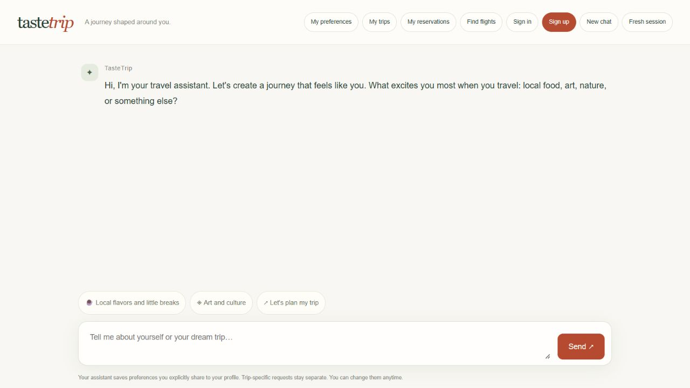
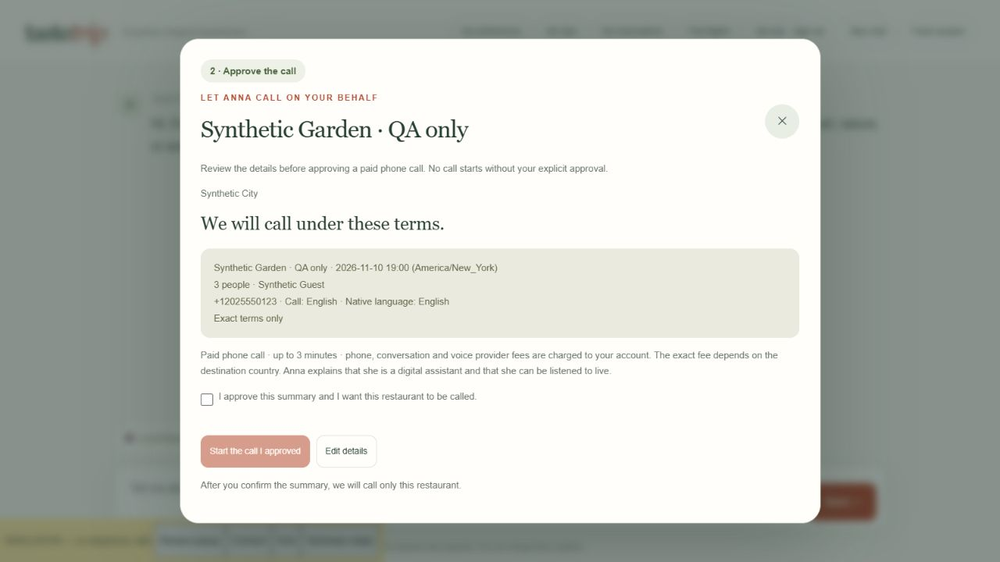
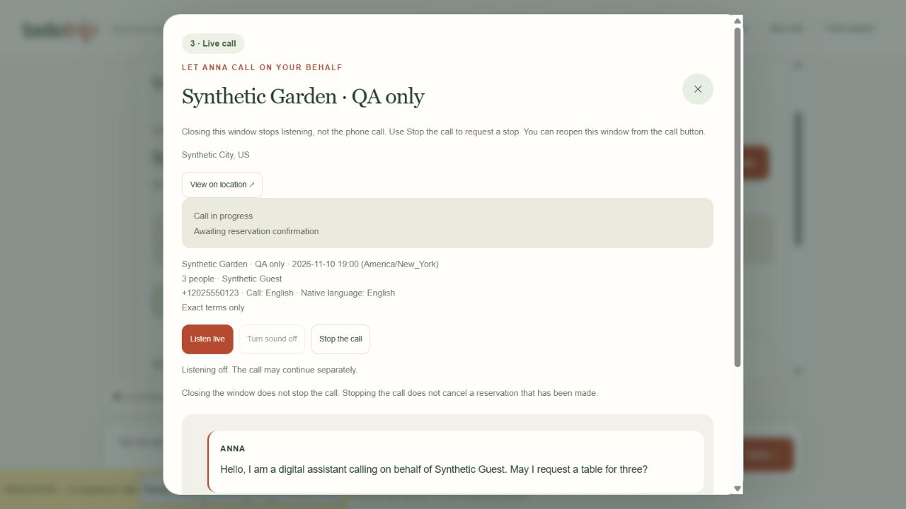

# TasteTrip

### A journey shaped around you — built for the Qloo Agentic Hackathon

**TasteTrip was built from scratch for the Qloo Agentic Hackathon.** It is a conversational travel concierge that turns a traveler's interests into personalized itineraries, cultural discoveries, and restaurant reservation requests. The application combines its own chat experience, taste-profile storage, itinerary workflow, and reservation orchestration with third-party APIs and open-source libraries.

[Live application](https://tastetrip.bahadirciftci.work) · [Installation guide](docs/INSTALLATION.md) · [Qloo Agentic Hackathon](https://qloo.devpost.com/)



## What you can do

- **Plan through conversation.** Share where you want to go, your dates, party size, and the things you enjoy. The assistant learns explicitly shared preferences and keeps trip-specific requests separate.
- **Discover places through Qloo.** Explore restaurants, cafes, bars, hotels, museums, parks, and attractions using a shared taste profile and destination context.
- **Shape and save your itinerary.** Ask to move an existing stop to another day, review the result, and save a route to your account.
- **Make waiting time part of the trip.** Request books, films, podcasts, artists, and other cultural recommendations for a break or journey. Content recommendations are triggered by the traveler.
- **Explore flight options.** Search city/airport matches and available cached Aviasales price data, with a link to check the offer at its source.
- **Ask Anna to call a restaurant.** Review the business phone number, local date/time, exact booking terms, and paid-call approval before a call starts. Follow live audio and native-language captions in a popup, then return to chat for a summary.

The interface starts in English. The assistant replies in the language of the traveler's message; the saved native-language preference separately controls call captions and summaries. Sign-in is requested for actions such as saving a route or preparing a reservation, rather than blocking initial exploration.

## Why Qloo matters

Qloo is the recommendation foundation, rather than a decorative API integration. TasteTrip resolves cultural favorites into Qloo entities, stores validated preferences in a reusable master profile, and sends relevant signals to place and content discovery. Travel themes, cuisines, budget, and applicable constraints help shape the candidate pool.

The LLM interprets conversation and organizes the returned candidates into an itinerary. Server validation constrains the generated plan to known candidates; the model does not replace Qloo's place and cultural discovery. Food-specific requirements apply to relevant place queries, rather than unrelated book or museum recommendations.

## Reservation experience





These two screenshots show the implemented interface using **synthetic QA data and a simulated conversation**. They do not represent a real restaurant booking.

A durable queue and worker handle approved call attempts. Twilio supplies telephony, Deepgram transcribes speech, an OpenAI-compatible LLM drives the conversation, and ElevenLabs provides Anna's voice. The assistant introduces herself as a digital assistant. The speech router uses Flash v2.5 for its supported languages and v3 for supported fallback languages, subject to the configured voice and speech-recognition capabilities.

Closing the popup stops browser listening, not the phone call. A separate stop control requests that the call end. When the call finishes, a summary appears in chat; the phone status and reservation outcome remain separate. An automatic summary is not proof of restaurant acceptance.

## Run locally

Requires **Python 3.12**, Git, and provider credentials for the features you want to use. A Node.js frontend build is not required.

```bash
git clone https://github.com/baadir/tastetrip.git
cd tastetrip
python -m venv .venv
```

**macOS / Linux**

```bash
source .venv/bin/activate
pip install -r requirements.txt
cp .env.example .env
# Configure .env as described below.
python -m app.server
```

**Windows PowerShell**

```powershell
.venv/Scripts/python.exe -m pip install -r requirements.txt
Copy-Item .env.example .env
# Configure .env as described below.
.venv/Scripts/python.exe -m app.server
```

Copy the example only when `.env` does not already exist. Open [localhost:8080](http://localhost:8080). Restart the relevant processes after changing environment variables.

For personalized planning, configure:

| Variable | Purpose |
| --- | --- |
| `QLOO_API_KEY` | Qloo API access |
| `QLOO_API_URL` | API origin; the example uses the hackathon endpoint |
| `LLM_API_KEY` | API key for the conversation/planning provider |
| `LLM_BASE_URL` | OpenAI-compatible API base URL; DeepSeek is the current integration |
| `LLM_MODEL` | Model enabled for your provider account, with JSON output support |
| `APP_ORIGIN` | Exact browser origin, locally `http://localhost:8080` |

Optional flight credentials: `AVIASALES_API_TOKEN` and `AVIASALES_PARTNER_ID`.

Voice reservations require additional credentials, a public HTTPS/WSS gateway, and two background processes. Follow the [complete installation guide](docs/INSTALLATION.md#voice-reservations) before enabling calls. Merely adding API keys does not start a voice service.

## Docker and Coolify

For the web application locally:

```bash
docker compose up --build -d tastetrip
```

The included Dockerfile uses Python 3.12 slim, runs as a non-root user, and supports native builds on ARM64 hosts such as Hetzner CAX21. The web service stores its database in a persistent Docker volume.

For a full Coolify installation, use **`/compose.coolify.yaml`**, which runs the web application, voice gateway, and reservation worker. Configure separate HTTPS domains for web and gateway, runtime environment variables, WebSocket routing, and a shared persistent data volume. See [Coolify setup](docs/INSTALLATION.md#coolify--production) and the [production runbook](docs/VOICE_PRODUCTION_RUNBOOK.md).

## Architecture

| Component | Responsibility |
| --- | --- |
| Flask + vanilla JavaScript/CSS | Conversational UI, API, authentication, and itinerary controls |
| SQLite | Taste profiles, drafts, saved routes, sessions, reservation attempts, and outbox |
| Qloo Taste AI | Taste-based place and cultural recommendations |
| DeepSeek / OpenAI-compatible LLM | Preference extraction, planning, edits, and voice conversation |
| Aviasales / Travelpayouts | Airport discovery and cached flight price exploration |
| Twilio + Deepgram + ElevenLabs | Outbound calls, speech recognition, and synthesized speech |
| Reservation worker + voice gateway | Durable dispatch, live media, captions, and summaries |

## Verification and current limits

```bash
# Run inside the activated virtual environment.
python -m unittest discover -s tests -v
```

The latest recorded full test run passed **126 tests**. Synthetic browser checks cover the reservation verification, separate paid-call approval, popup close/reopen, and summary handoff. These checks do not certify a new live restaurant booking.

- Qloo coverage and available metadata vary. Images, phone numbers, menus, and other fields may be missing.
- Itineraries do not guarantee real travel times, date-specific opening hours, or reservation availability.
- Current natural-language itinerary edits rearrange existing stops; arbitrary additions/removals are not supported.
- Flight prices are cached discovery data, not confirmed ticket inventory or ticket purchasing.
- Book and podcast recommendations offer language filtering; unknown or nonmatching candidates are excluded. Inventory in every language is not guaranteed. Film-language filtering is not implemented.
- Music discovery recommends artists; it does not provide a playable music playlist.
- Accounts currently use username/password authentication. Password recovery, email verification, and OAuth are not implemented.
- Voice calls incur provider charges and require explicit approval. By default, attempts are limited to 10 per user per day and 180 seconds per call; transcripts/summaries are retained for 30 days. These are not a total spending cap.

Keep `.env`, API credentials, and local databases private. They are excluded from version control. See the [installation guide](docs/INSTALLATION.md) for configuration, persistence, and troubleshooting.

## License

TasteTrip application code is available under the [MIT License](LICENSE). Third-party services, libraries, and content remain subject to their respective terms and licenses.
