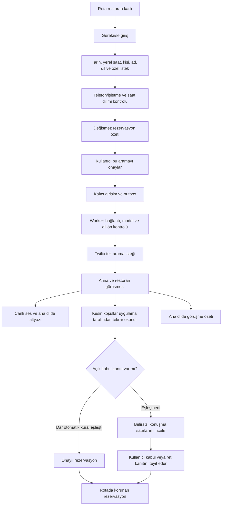

# Restoran rezervasyonu — uygulama ve işletim

22 Ekim 2026. D-031/H-069. Bu belge çalışan ilk restoran masa rezervasyonu entegrasyonunu tanımlar; bütün ürün kabul kriterlerinin veya gerçek restoran görüşmesinin doğrulandığı anlamına gelmez.

## Kullanıcı akışı



- Masa rezervasyonu restaurant/cafe/bar türleriyle sınırlı. Otel odası/müze bileti bu adaptörle aranmaz. Numara seçili duraktan sunucuda çözülür; istemci serbest hedef telefon gönderemez.
- Ülke ve ana dil açık seçilir. Ülke→görüşme dili ve bazı ülkeler için saat dilimi yalnız başlangıç önerisidir. Kullanıcı işletme ve yerel saat eşleşmesini kontrol eder. Çoklu saat dilimli ülkelerde otomatik kesin atama yok. IANA saat dilimi, gelecekteki zaman ve DST'de olmayan/çift yaşanan saatler denetlenir.
- Prepare arama yapmaz; onay özetini 10 dakika geçerli olarak saklar ve bağlam kaybolmasın diye rotayı hesaba kaydeder. UI bunu açıklar. Start, aynı rota sürümü ve özet digest'i için ayrı onay ister.
- İlk sürüm yalnız kesin tarih/saat/kişi sayısını ister. Alternatif saat, depozito/ödeme ve kapsam dışı taahhüt agent talimatlarında yasak. Canlı alternatif teklif için kullanıcı karar kartı henüz yok; önceden kabul edilmiş alternatif aralığı da uygulanmadı. Doğal dil agentının bu sınırdaki gerçek konuşma davranışı ayrıca kontrollü aramada test edilmeli.
- Anna gerçek ürün görüşmesinde dijital asistan olduğunu ve müşterinin canlı dinleyebildiğini açıklar. Eski sabit deney senaryosunun “testtir, rezervasyonu iptal et” promptu ürün aramasına taşınmaz. Eski demo butonları/senaryoları ayrı kalır.

## Kalıcı durum ve sonucu doğrulama

`reservation_requests`, `reservation_attempts`, `reservation_outbox`, `reservation_events`, `reservation_worker_heartbeat` aynı SQLite volume'undadır. Bir aktif/belirsiz ürün girişimi; atomik claim ve onaydan önce kalıcı outbox. Aynı idempotency anahtarı aynı girişimi döndürür. Dış create-call POST otomatik tekrarlanmaz. Yanıt kaybında `unknown`; yeni arama engellenir. SID geldiyse sağlayıcı GET ile uzlaştırılır. SID'siz belirsiz olayda operatörün Twilio kaydını incelemesi gerekir; otomatik eşleştirme veya yeniden arama yok.

Arama `queued / initiating / ringing / connected / ended / failed / busy / no_answer / canceled / rejected / unknown`. Rezervasyon ayrıca `pending / confirmed / declined / unknown / not_completed`. Telefon tamamlandı durumu rezervasyon onayı değildir.

Dar otomatik onay yalnız şu kanıt zincirinde çalışır:

1. Product agent JSON `readback` aksiyonunu seçer. LLM'nin önerdiği sözde yeni koşullar kullanılmaz; uygulama onaylı ad/tarih/saat/kişi için sabit teyit metnini okur.
2. Bu metnin Twilio playback mark teyidi gelmeden `readback` kanıtı yayınlanmaz. Kesilen metin tamamlandı sayılmaz.
3. Hemen sonraki restoran final cümlesi, İngilizce veya Türkçe için küçük ve açık kabul kümesindeki tüm cümleyle eşleşir. Örneğin `Your reservation is confirmed.`; uygunluk ifadesi veya soru kabul değildir.
4. Backend, doğru girişim ve gerçek okunan kesin koşullarla olayları eşler; source `restaurant_exact_reply` olur. Sonradan gelen açıklanmamış restoran düzeltmesi sonucu belirsize düşürür. Normal teşekkür/veda bu dar kuralın dışında tutulur.

Bu, tüm doğal dil ifadelerini anlayan evrensel onay motoru değildir. Diğer ifade/diller ve eksik/çelişkili konuşmada `unknown` gösterilir; kullanıcı restoran satırını ve kesin koşulları inceleyerek kabul/ret teyidi yapabilir (`user_review`). Sistem bu iki kaynağı ayırır. Otomatik özet tek başına onay yazamaz. Özel isteğin karşılanması masa onayından ayrı; kaynakta teyit edilmedikçe garanti verilmez. Referans yalnız restoranın seçilen ifadesinde gerçekten geçiyorsa girilir; verilmediyse boş kalır.

Onaylı sonuç aynı plan/durağa yansır ve mevcut planlayıcının onaylı durağı başka güne taşıma engelini kullanır. Rota düzenleme veya aramayı durdurma gerçek rezervasyonu iptal etmez. Bilinen başarısız/ret sonucundan sonra yeni girişim, önceki girişim ID'sini açık retry olarak belirtir; onaylı/belirsiz sonuçta bu yol kapalıdır.

## Ses, altyazı ve özet

- Twilio Media Streams → ayrı aiohttp gateway → Deepgram Nova-3 → DeepSeek → ElevenLabs Anna. μ-law 8kHz mono telefon hattı ve iki taraflı yetkili dinleme.
- `conversation_language` model seçimini belirler; ana dil ve UI dili seçime karışmaz. BCP47 base normalizasyonu, Nova-3 kesişimi ve ElevenLabs model snapshot'ı kullanılır: Flash v2.5 destekliyorsa Flash, aksi halde destekliyorsa v3; destek yoksa arama öncesi durur.
- Snapshot `app/voice_models.json`, 22 Ekim canlı model listesinden. Worker, aramadan önce seçilen modelin güncel dil desteğini yeniden doğrular. Yetki/kota hatasında sessiz model değiştirme yok. Snapshot'ı güncellemeden yeni dil eklenmiş sayılmaz. Eski sabit demoların modeli bu entegrasyonla değiştirilmez.
- TR/EN dışındaki açılış/teyit/sessizlik metinleri ücretli aramadan önce hazırlanır; tarih/saat/ad/kişi literal değerleri denetlenir. Bu dillerin tümünde gerçek telefon kalitesi test edilmedi.
- Canlı dinleme user/attempt sahipliğiyle üretilen 30 saniyelik, tek kullanımlı WSS token'ı gerektirir; anahtar/provider URL'si istemciye gitmez. Bağlantı en fazla 240 saniye; dört dinleyici ve sınırlı buffer. Ses yalnız bellekte, dosya/DB/ses kaydı yok. İki kanaldaki gecikme/kayıp açık gösterilir.
- Final konuşma satırları kalıcı ve tekrar teslimatta dedup edilir. Worker, kullanıcının ana diline çevirir; başarısızsa orijinal ve hata durumu görünür. Çeviri STT'nin doğru anladığını kanıtlamaz. Transkript gap/servis hataları gizlenmez.
- Arama sonunda ana dilde özet, gerçek event ID'lerine dayandırılır. Transcript sürümü değişirse eski özet commit edilmez, yeniden hazırlanır. Özet tekrar denemesi telefon araması oluşturmaz.
- Metin/özet/açılış script'i 30 günlük saklama sınırına tabi; worker saatlik, servis açılışı da temizlik yapar. Rezervasyonun koşulları ve durum kaydı bu temizlikte iptal edilmez. Ses arşivi tutulmaz.

## Yerel servisler

```powershell
.venv/Scripts/python.exe -m app.server
.venv/Scripts/python.exe -m app.voice_gateway
.venv/Scripts/python.exe -m app.reservation_worker
```

Web 8080, gateway 8081; worker port açmaz. `VOICE_PUBLIC_URL` erişilebilir HTTPS gateway origin'i, `APP_ORIGIN` tam web origin'i olmalı. Yerelde mevcut geçici Cloudflare tüneli yalnız gateway'i açar. Tünel kapanırsa worker dış health kontrolünden geçemez ve yeni ücretli arama yapmaz. `.env` veya geçici URL değişince üç servis yeniden yüklenmelidir. Yerel test monitor'ü 8081/monitor olarak ayrı durur.

`RESERVATION_WEB_URL=http://127.0.0.1:8080`, `VOICE_GATEWAY_INTERNAL_URL=http://127.0.0.1:8081`; aynı `VOICE_MONITOR_TOKEN` üç serviste yalnız sunucuda. Günlük kullanıcı girişim limiti varsayılan 10 (`RESERVATION_DAILY_LIMIT`), bir görüşme en fazla 180 saniye. Bu parasal bütçe garantisi değildir. Gateway telefon dispatch lease'i ürün ve eski yerel demo çağrılarını birbirinden korur.

## Coolify / CAX21

`compose.yaml` web, voice-gateway ve reservation-worker içerir. Web/worker aynı kalıcı volume ve UID ile çalışır; gateway web'in dahili API'sini kullanır, DB paylaşmaz. Tek worker ve web instance ile başlayın. Gateway için ayrı HTTPS/WSS domain'i 8081'e yönlendirin; web domain'ini APP_ORIGIN, gateway domain'ini VOICE_PUBLIC_URL olarak verin. Compose içindeki `RESERVATION_WEB_URL=http://tastetrip:8080`, `VOICE_GATEWAY_INTERNAL_URL=http://voice-gateway:8081` değerleri korunur. Web/gateway/worker healthcheck'leri ayrı; üretimde sabit hedef demo çağrıları kapalı.

Mevcut Python 3.12 slim tabanı korunur; yeni phonenumbers/tzdata bağımlılıkları pure Python/evrensel wheel. Yerel Docker/gerçek ARM64/Coolify yayın testi yapılmadı. Web, WSS proxy, ağ/volume ve restart kontrollü pilotta ayrıca doğrulanmalı. Geçici tünel üretim URL'si değildir.

## Kanıt ve sınırlar

- REST sahiplik/onay/tekrar/TTL/saat dilimi, outbox timeout/restart davranışı, deterministik kabul ve düzeltme, geç event/özet yarışı, WSS scope/replay/Origin ve sentetik iki taraflı ses aktarımı testleri.
- Canlı ElevenLabs Flash TR ve v3 Afrikaans için `ulaw_8000` streaming HTTP200; yalnız küçük ses denemesi. `docs/validation/reservation-voice-contract-2026-10-22.json` byte/success kanıtını taşır, ses veya sır içermez.
- Tarayıcı form→özet kapısı ayrı sentetik QA verisiyle kontrol edildi. `scripts/reservation_ui_preview.py` yalnız loopback, sahte kimlik ve kapalı telefon anahtarıyla çalışır; ürün veya deploy giriş noktası değildir. Ürün DB'sine sentetik rezervasyon yazılmadı.
- Bu tur gerçek telefon araması/rezervasyon veya Coolify deployment yapılmadı. Yeni ürün promptu, otomatik onay ifadesi ve tüm canlı altyazı yolunun gerçek restorandaki gecikme/başarı kalitesi henüz doğrulanmadı. Önce kullanıcının izin verdiği kontrollü telefonla gerçek uçtan uca test yapılmalı.

Resmî kaynaklar: [Twilio Call resource](https://www.twilio.com/docs/voice/api/call-resource), [Media Streams custom parameters](https://www.twilio.com/docs/voice/twiml/stream), [Deepgram Nova-3 dil listesi](https://developers.deepgram.com/docs/models-languages-overview/). Model desteği telefon kalitesi veya rezervasyon müsaitliği garantisi değildir.


### 28 October 2026 — D-039: Reservation call popup
The explicit user instruction supersedes the reservation/live-call portion of D-033 (including AC-15.8's live-call card surface). Booking details remain conversational; business/phone and local-time verification, separate paid-call approval and live listening/captions/stop controls open in a modal over chat. Closing the modal stops listening and preserves call tracking; an active-call button reopens it. A terminal followed call closes the popup and shows one updating summary card in chat. Completed transcripts/outcome review can be reopened. Existing server approval, digest, ownership and idempotency checks remain unchanged. Local implementation/verification and deployment limits: [Popup contract](ux/12-reservation-call-popup.md). PROJECT_HISTORY D-039/H-082 is the authoritative verification record.
