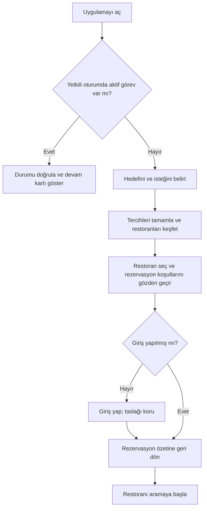

# TasteTrip Concierge — Kullanıcı durumu, açılış ve giriş

Tarih: 20 Ekim 2026. Durum: tartışma taslağı; ürün sahibi tarafından henüz onaylanmış UX kararı değil.

> 21 Ekim güncellemesi: Girdi seçenekleri, kategori temizliği, metadata ve açık UX sorularına ilişkin canlı kanıtlar [API'ye dayalı UX önerilerinde](04-api-backed-ux-recommendations.md). İlk tartışma aşağıda tarihsel olarak korunuyor. Yeni kanıt, login veya görsel yön için kullanıcı onayı yerine geçmez.

## 1. Bu çalışmanın sınırı

Kullanıcının yönlendirmesi: önce kullanıcının durumunu, login zamanını ve açılış ekranını netleştirmek. Restoran listesi ve canlı görüşme ekranlarının detay tasarımı bu belgenin konusu değil.

Kaynaklar: [Ürün gereksinimleri](../../PRODUCT_REQUIREMENTS.md), mevcut konuşmadaki seyahat odağı ve desktop/mobil responsive beklentisi. Kullanıcı görüşmesi, prototip testi veya gerçek davranış verisi henüz yok. Aşağıdaki tercihler tasarım hipotezleridir.

## 2. Kullanıcının state'i tek bir login bayrağı değil

Birbirinden bağımsız şu durumları izlemeyi öneriyorum:

| Boyut | Olası durumlar | UX'e etkisi |
| --- | --- | --- |
| Kimlik | Oturum yok / giriş yapılmış / oturum süresi dolmuş | Hangi bilgi kişiye ait gösterilebilir; işlemin hangi aşamasında giriş istenir |
| Amaç | Seyahat öncesi / seyahatte / henüz belli değil | Varsayılan tarih ve dil; bugün için karar baskısı varsayılmaz |
| Konum bağlamı | Hedef bilinmiyor / kullanıcı bir şehir seçmiş | Önerinin hangi şehir için olduğu görünür kalır |
| Tercih bilgisi | Bilinmiyor / bu oturumda girilmiş / kaydedilmiş | Tekrar soru sormak yerine düzenlenebilir özet gösterilir |
| Görev | Başlanmamış / keşif taslağı / restoran seçilmiş / arama sürüyor / sonuç var | “Yeni arama” mı, “Kaldığın yerden devam et” mi öncelikli? |
| Bağlantı | Bağlı / yavaş / kopmuş | Taslağın korunması ve devam eden aramanın gerçek durumunun doğrulanması |

Oturum açmış olması seyahatte olduğunu kanıtlamaz. Cihazın konumu gidilecek yer olmayabilir. Arayüz dili, ana dil veya restoranla konuşulacak dilin kesin kanıtı değildir.

## 3. Açılışta hangi öncelik gösterilmeli?

| Giriş koşulu | İlk görünüm | Ana eylem | Korunacak bağlam |
| --- | --- | --- | --- |
| İlk ziyaret, oturum yok | Kısa değer önerisi + hedef şehir + isteğini yazma alanı | “Restoran bul” | Girilen şehir ve niyet |
| Oturum yok, bu cihazda keşif taslağı var | “Aramana devam et” kartı; yeni arama da mümkün | “Devam et” | Önceki girdiler; hassas rezervasyon ayrıntıları gereksiz yere açılışta gösterilmez |
| Giriş yapılmış, aktif görev yok | Kısa başlangıç alanı; kaydedilmiş tercihler varsa düzenlenebilir özet | “Restoran bul” | Kullanıcının görünür olarak seçtiği tercihler |
| Giriş yapılmış, keşif yarım | Özet: şehir, tarih varsa tarih, son adım | “Kaldığım yerden devam et” | Filtreler, seçilen aday, liste konumu |
| Yetkili oturumda arama sürüyor | Yeni keşiften önce aktif arama kartı | “Görüşmeyi aç” | Arama kimliği ve doğrulanmış durum; ses kullanıcı başlatınca |
| Giriş yapılmış, yaklaşan rezervasyon var | Rezervasyon kartı + yeni keşif alanı | “Rezervasyonu görüntüle” | Yerel tarih/saat, doğrulanmış sonuç |
| Rezervasyon bağlantısıyla gelmiş, oturum yok | Kişisel ayrıntıları göstermeyen giriş kapısı | “Giriş yap ve görüntüle” | Güvenli dönüş hedefi |

Öncelik önerisi: aktif görüşme → devam eden rezervasyon görevi → yaklaşan rezervasyon → yeni keşif. Bu öncelik gerçek kullanıcıyla sınanmalı.

## 4. Login nerede olmalı?

| Seçenek | Avantaj | Maliyet / risk |
| --- | --- | --- |
| Açılışta zorunlu | Hesap ve kayıt baştan hazır | Kullanıcı ürünün değerini görmeden hesap işlemi yapar |
| Seçimden sonra, telefon aramasından önce | Önce adayları görür; rezervasyon işi hesaba bağlanır | Giriş araya girer; görev mutlaka korunmalı |
| Rezervasyon sonrasında | İlk akış daha az kesilir | Hesapsız arama yetkisi, kötüye kullanım ve sonuca tekrar erişim tasarımı gerekir |

**Başlangıç önerisi: keşif misafir erişimine açık; login telefonla işlemden önce.** Üst köşedeki “Giriş yap” her zaman isteğe bağlı bir erken yol. Kaydedilmiş tercihleri veya başka cihazdaki rezervasyonları görmek isteyen kullanıcı erken giriş yapabilir.

Bu bir kullanıcı talebi değil, tartışılacak ürün önerisidir. Hesabın telefon araması için teknik zorunluluk olduğunu iddia etmiyoruz; kimlik, işlem sahipliği ve geri dönüş tasarımını sadeleştiren başlangıç sınırı olarak öneriyoruz.

### Önerilen sıra



Giriş işlemi hiçbir zaman otomatik telefon araması başlatmaz. Restoran, tarih ve yerel saat geri dönüşte görünür kalır; arama ayrı ve açık bir eylemdir. Son gözden geçirme sonrasında koşul değişirse özet yeniden güncellenir.

### Giriş yüzeyinin davranış sözleşmesi

- Geçici taslak girişten önce korunur; saklama yöntemi ve süresi uygulama öncesi netleştirilir.
- Desktop'ta odaklanmış diyalog veya ayrı giriş ekranı; mobilde tam ekran giriş yüzeyi. SSO yönlendirmesinden sonra aynı taslağa dönüş.
- “Giriş yap ve devam et” hesabın sağlayacağı faydayı belirtir: rezervasyon sonucuna yeniden erişim ve kaldığı yerden devam.
- Giriş iptal edilirse restoran seçimine/özete dönülür; keşif kaybolmaz.
- Giriş başarısızsa taslak korunur ve yeniden deneme sunulur.
- Başka hesapla girişte önceki hesaba ait rezervasyonlar taşınmaz. Misafir taslağının bağlanması açık ve sınırlı yapılır.
- Oturum arama sırasında sona ererse oturum hatası ve telefon araması ayrı durumlar olarak gösterilir; yeniden giriş ikinci arama yaratmaz.
- Google/e-posta yöntemi henüz seçilmedi. Formu yalnızca e-posta istemekle basitleştirmek başka bir sağlayıcıya bağımlılık gerektirir; şimdilik bir özellik vaadi değil.

## 5. İlk açılış sayfası nasıl hissettirmeli?

Kullanıcı önce “Burası seyahatimde yemek bulup rezervasyon yapmama yardım ediyor” mesajını anlamalı. Bunun için seyahat bağlamını başlığa ve konum seçimine yerleştirelim.

Önerilen içerik:

- Üst bölüm: marka ve ikincil “Giriş yap”. Ürün henüz boşken geniş dashboard menüsü yok.
- Başlık: **“Seyahatinde damak zevkine uygun bir masa bul.”**
- Açıklama: **“Restoranları keşfet. Seçtiğin restoranı senin için arayalım; görüşmeyi kendi dilinde takip et.”**
- Hedef alanı: **“Nerede yemek yemek istiyorsun?”** Şehir veya bölge araması; cihaz konumu ayrı, isteğe bağlı bir kolaylık.
- Doğal dil alanı: **“Nasıl bir akşam düşünüyorsun?”** Örnek: “Mumbai'de yarın iki kişilik, sakin bir akşam yemeği.” Bu örnek gerçek veri kapsamı vaadi değildir.
- Alternatif giriş: **“Seçeneklerle ilerle”**; yazmak istemeyen kullanıcıya kısa seçimler açar.
- Ana eylem: **“Restoran bul”**. Eksik şehir varsa ilgili alanda açıklama; yazdıkları korunur.
- Kısa süreç anlatımı: **“Keşfet → Seç → Aramamızı canlı takip et.”**

Başlangıçta zorunlu uzun profil, müzik/film anketi veya hesap oluşturma istemeyelim. İstekten zaten çıkan bilgiyi tekrar sormayalım. Zevk sinyalleri eksikse sonraki adımda örneklerle ve atlanabilir biçimde isteyelim. Her tercihi API'nin desteklediği kavrama eşlemeyi uygulama üstlenir; kullanıcı entity/tag dili görmez.

### Seyahat öncesi / seyahat sırasında

Bu ayrım henüz seçilmedi. Açılış tek bir senaryoya kilitlenmesin: kullanıcı doğal dilde “gelecek hafta” veya “bu akşam” diyebilir; sistem çıkardığı tarihi düzenlenebilir özetle doğrular. Tarih verilmediyse bugün seçilmiş gibi gösterilmez. Rezervasyon tarihi restoranın yerel gününe göre açık hale getirilir.

## 6. Chatbot mu, adımlı asistan mı?

Bu aşama için öneri: **asistan destekli bir başlangıç ekranı**. Boş bir sohbet geçmişiyle başlamayalım. Kullanıcı ister yazar, ister seçeneklerle ilerler; ikisi aynı görev taslağını oluşturur.

| Model | Bu ürün için güçlü taraf | Zayıf taraf |
| --- | --- | --- |
| Tam chatbot | Belirsiz istek ve düzeltmeler esnek | Özet ve karşılaştırma sohbet içinde kaybolabilir |
| Tam wizard | Gerekli alanlar ve ilerleme görünür | Her kullanıcıya aynı sorular sorulabilir; basit iş uzun hissedebilir |
| Hibrit — öneri | İfade esnekliği + görünür seçim ve kontrol | Metin ve form durumunu aynı anda tutarlı tutmak gerekir |

İlk karar noktası: açılışta tek bir doğal dil alanı ve görünür şehir seçimi. Daha sonraki ekranlar için hibrit model henüz kesinleşmiş sayılmaz. Kullanıcılarda yazma belirsizliği görürsek seçeneklerle ilerleme yolunu daha baskın yaparız.

## 7. Desktop ve mobil açılış kurgusu

### Geniş ekran — içerik sırası

```text
[TasteTrip]                                           [Giriş yap]

Seyahatinde damak zevkine               Kısa destekleyici görsel
uygun bir masa bul.                    veya süreç açıklaması

[Nerede yemek yemek istiyorsun?                              ]
[Nasıl bir akşam düşünüyorsun?                               ]
[Seçeneklerle ilerle]                         [Restoran bul]

Keşfet → Seç → Aramamızı canlı takip et
```

### Dar ekran — içerik sırası

```text
[TasteTrip]             [Giriş yap]

Seyahatinde damak zevkine
uygun bir masa bul.
Kısa açıklama

Nerede yemek yemek istiyorsun?
[Şehir veya bölge               ]

Nasıl bir akşam düşünüyorsun?
[İsteğini yaz                   ]
[                               ]

[Restoran bul                   ]
[Seçeneklerle ilerle            ]

Keşfet → Seç → Canlı takip et
```

Bu şemalar uygulama ekranı veya bitmiş görsel tasarım değil, yerleşim tartışma araçlarıdır.

Responsive davranış: destekleyici görsel alan daraldığında aşağı alınır veya kaldırılır; görev alanları kalır. Metin ve alanlar büyüyebilir, düğme etiketleri kesilmez. Mobil klavye açılınca aktif alan ve hata erişilebilir kalır; büyük sabit alt panel içerik örtmez. Dokunma için hover gerekmeyen eylemler, masaüstünde klavye sırası: giriş → şehir → niyet → ana eylem → alternatif yol. “Seçeneklerle ilerle” açılırsa odağı yeni bölüm başlığı/ilk alanına taşı; kapanınca açan düğmeye geri getir.

Önerilen inceleme genişlikleri 360, 390, 768 ve 1440 CSS px; ayrıca 320 CSS px reflow, büyütülmüş metin, yatay ekran ve uzun çeviriler. Bunlar test planıdır; yapılmış test veya erişilebilirlik uygunluğu beyanı değil.

## 8. İlk ekranın durumları

| Durum | Görünen içerik | Sonraki eylem / geri dönüş |
| --- | --- | --- |
| Şehir seçilmemiş | Etiketli boş alan; önerilen örnekler gerçek kapsam vaadi değil | Kullanıcı şehir seçer |
| Aynı adlı birden fazla şehir | Ülke/bölge bilgili adaylar | Kullanıcı netleştirir; yanlış şehir sessiz seçilmez |
| İstek işleniyor | “İsteğini hazırlıyoruz” ve girilen metin | Yeni gönderim bekler; sahte yüzde ilerlemesi yok |
| Çıkarılan tarih/kişi belirsiz | “Tarihi netleştirelim” veya düzenlenebilir özet | Eksik bilgi tamamlanır |
| Kapsam doğrulanmamış / sonuç yok | Bu aramada sonuç olmadığı açıklanır | Bölgeyi genişlet veya değiştir; tüm ülke yokmuş gibi genellenmez |
| Çevrimdışı | “Bağlantı yok. Yazdıkların bu ekranda duruyor.” | Bağlantı sonrası yeniden dene; sunucuya kaydedildi denmez |
| Aktif arama yeniden açılıyor | “Görüşme durumunu kontrol ediyoruz” | Mevcut arama doğrulanır; yeni telefon araması başlatılmaz |

## 9. Kanıt ve kontrol sınırı

| Bilgi / işlem | Kaynak / yetki | Eksik veya çelişkili durumda |
| --- | --- | --- |
| Hedef ve tercihler | Müşterinin girdileri; görünen özet | Soru sor, kullanıcı düzeltir |
| Restoran adayları | Qloo + doğrulanacak işletme verisi | Veri yoksa açıklama; aday uydurma yok |
| Kullanıcı hesabı | Kimlik servisi; işlem sahipliği | Oturumu yenile; başka hesap verisini gösterme |
| Telefon araması | Restoran ve koşullar için açık müşteri eylemi | Girişin kendisi yetki sayılmaz |
| Aktif işlem / sonuç | Arama servisi ve uygulama durum kaydı | Belirsizliği göster; yinelenen arama yapma |

Varsayılan davranış önerisi: konum izni açılışta istenmez. İletişim ve rezervasyon kişisel bilgileri yalnızca gerektiği aşamada alınır. Arayüzde Qloo/TTS/telephony terimlerini ana görev etiketlerine taşımayalım.

## 10. Doğrulama planı — henüz uygulanmadı

Sahte senaryo ve verilerle bir sonraki prototipte şu soruları sınayalım:

1. İlk gelen kişi birkaç saniyede ne yapabileceğini anlatabiliyor mu? Bu bir hedef sorusu; ölçülmüş sonuç değil.
2. Giriş yapmadan keşfe başlayabileceğini fark ediyor mu?
3. Gideceği şehir ile mevcut konumunu ayırabiliyor mu?
4. Doğal dil ve seçenekli yol arasından kendi başına başlayabiliyor mu?
5. Girişten sonra seçtiği restoranı ve rezervasyon koşullarını bulabiliyor mu?
6. Giriş yapmakla telefon aramasının başlamadığını anlıyor mu?
7. Dar ekranda ve klavyeyle bir alan hatasını girdilerini kaybetmeden düzeltebiliyor mu?
8. Devam eden aramaya dönüşte ikinci arama başlatmadan ilerleyebiliyor mu?

Gözlem tablosu bilinçli olarak boş: katılımcı, alıntı veya test sonucu üretilmedi. Prototipte aramalar simülasyon olarak açıkça işaretlenmeli. Gerçek katılımcı toplama/kayıt için ayrı çalışma planı gerekir; şu anda yapılmıyor.

## 11. Açık kararlar ve sonraki adım

| Karar | Öneri | Sahip | Ne zaman çözülecek? |
| --- | --- | --- | --- |
| Login zamanı | Restoran seçimi ve koşulların gözden geçirilmesinden sonra, aramadan önce | Ürün sahibi ile birlikte | Bu UX görüşmesinde |
| Açılış modeli | Konum + doğal dil, alternatif seçenekli yol | Ürün sahibi ile birlikte | İlk düşük detaylı prototipten önce |
| İlk ziyaret bağlamı | Seyahat öncesi/sırası varsayılmasın | Ürün sahibi | Giriş ekranı metni kesinleşirken |
| Hesap yöntemi | Henüz seçilmedi | Ürün/uygulama | Giriş prototipinden önce |
| Taslak saklama | Kesintide koru; süre ve hassas alan politikasını belirle | Uygulama/ürün | Gerçek veri entegrasyonundan önce |
| Mobil arka plan araması | Bağlantı/oturumdan ayrı gerçek arama durumu | Uygulama | Canlı görüşme tasarımından önce teknik deney |

Sonraki somut çıktı: bu kararlar tartışıldıktan sonra ilk ziyaret, geri dönüş ve girişten dönüş için üç düşük detaylı ekran. Henüz uygulama kodu veya tamamlanmış mühendislik devri yok.

## 22 Ekim 2026 — Onboarding kapsamı güncellemesi
D-029 ile kullanıcı tercihlerinin onboarding üzerinden toplanması ve kalıcı ortak profil olarak kullanılması istendi. Güncel akış/soru/model önerisi 08-onboarding-and-taste-profile.md içinde. İlk tartışmadaki login belirsizliği D-010 ile işlem anında giriş olarak kapanmıştır. Yeni adım sırası henüz kabul edilmiş veya uygulanmış değildir; önceki tartışma tarihsel kayıt olarak korunur.
