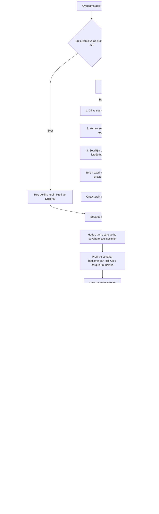
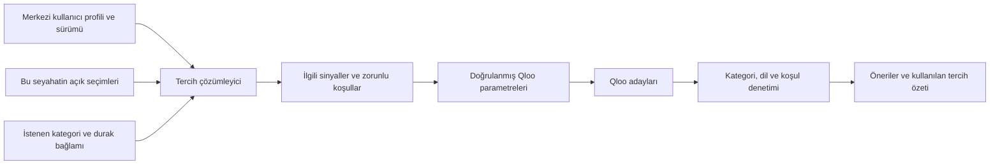

# Onboarding ve kalıcı kullanıcı zevk profili

**Güncel durum — D-030/H-068:** Kullanıcı planı geliştirmeye alma talimatı verdi. Ortak profil ve üç adımlı onboarding uygulandı; aşağıdaki ilk plan tarihi tasarım kaydı olarak korunur. Gerçek kapsam ve sınırlar belgenin sonundaki uygulama kaydındadır. 71 test geçti; canlı kontrat ve tarayıcı doğrulamaları yapıldı.

Tarih: 22 Ekim 2026. D-029 kullanıcı talebi: onboarding ile tercihleri toplamak ve sonraki önerilerde ortak kullanıcı verisi olarak kullanmak. **Aşağıdaki ekran sırası, soru sayıları ve teknik model tasarım önerisidir; uygulanmadı, kullanıcı araştırmasıyla doğrulanmadı.** D-010 girişin işlem anında olması ve D-009/D-015 içerik önerisini kullanıcının tetiklemesi korunur.

## 1. Amaç ve mevcut durum

Kullanıcının bir defa anlattığı zevkleri her seyahatte yeniden sormamak; ilgili tercihlerle Qloo adaylarını kişiselleştirmek. Tam profil doldurmak teknik önkoşul yapılmaz: eksik profil bağlamla keşfi engellemez. Kişiselleştirme sonucunun daha iyi olduğu kullanıcı değerlendirmesiyle ayrıca ölçülmelidir.

Kod incelemesi: `app/server.py` içinde ziyaretçi `prefs`, ayrı `media_preferences` ve seyahat taslağı var. `/api/preferences` seyahat şemasını kaydediyor. `app/planner.py` rota ilgilerini kategori sorgularına aktarıyor; medya önerileri ayrıca eser/konu ve durak bağlamı kullanıyor. Bağımsız, hesapla taşınan ve bütün öneri yollarınca çözümlenen master profil henüz yok. Mevcut kayıtlardan yeni profile geçiş gerekir; bu belge mevcut uygulama özelliği değildir.

Kanıt: önceki canlı Qloo deneyleri `04-api-backed-ux-recommendations.md`, mevcut `app/providers.py`, `app/server.py`, `app/planner.py`. İlk giriş tartışması `01-entry-and-login.md`; yeni akış oradaki uzun zorunlu anketten kaçınma yönünü kısa ve atlanabilir onboarding ile geliştirir.

## 2. Önerilen ana akış

Onboarding sonunda başarı mesajı: “Tercihlerin bu cihazda hatırlanacak. Tercihlerim bölümünden değiştirebilirsin.” Hesaba bağlıysa “hesabında” denir. Kullanıcı hatırlamayı kapatırsa yalnız mevcut oturum/seyahat için kullanılır; kalıcılık iddiası gösterilmez. Hesap girişi ayrı işlemdir.

## 3. Sorular: kullanıcıya gösterilecek metin ve cevap biçimi

İlk bölüm için hedef süre yaklaşık 60–90 saniye bir **tasarım hedefidir**, ölçülmüş süre değildir. Her adım atlanabilir; hiçbir seçim varsayılan olarak yapılmış sayılmaz.

| Aşama | Sorulacak soru | Cevap biçimi / örnek seçenekler | Kayıt ve kullanım |
|---|---|---|---|
| İlk tanışma | “Hangi dilde devam edelim? Görüşme altyazılarını hangi dilde görmek istersin?” | Arayüz ve ana dil ayrı dil seçiciler; tarayıcı dili yalnız değiştirilebilir öneri | `locale.ui_language`, `locale.native_language`; doğrudan Qloo zevk sinyali değil |
| 1 | “Seyahatte en çok neler seni heyecanlandırır?” | Görselli çoklu seçim: yerel yemek, kahve, müze/sanat, tarih/mimari, doğa/park, gece hayatı; “Diğer” metni. Başlangıçta 2–4 seçim önerisi | Uygulama ilgi alanları; uygun gerçek Qloo etiketine eşlenirse ayrıca doğrulanmış sinyal |
| 2 | “Hangi mutfakları seversin?” | Çoklu mutfak araması; İtalyan/Japon/Türk örnekleri; “Yeni tatlara açığım”, “Tercihim yok” | Seçilmiş gerçek etiket kimlikleri; varsayılan yumuşak tercih |
| 2 | “Nasıl yerlerde vakit geçirmeyi seversin?” | Sakin, romantik, açık havada gibi gerçek katalogla eşleşen seçenekler; her biri için “Tercihim / Olmazsa olmaz” | Atmosfer tercihleri ve zorunlu koşullar ayrı |
| 2 | “Yemek seçiminde mutlaka dikkate almamız gereken bir şey var mı?” | Vegan/vejetaryen/helal seçenek; diğer özel istek veya alerji metni; “Yok” ve “Şimdi belirtmek istemiyorum” ayrı | Beslenme tercihi ve işletmeden teyit gerektiren koşul ayrı; etiket alerjen güvenliği garantisi değildir |
| 2 | “Genelde hangi fiyat aralığı sana uygun?” | Ekonomik / Orta / Yüksek / Esnek; “Seyahate göre seçerim” | Kalıcı varsayılan; seyahatte değiştirilebilir. Qloo fiyat seviyesi kesin para tutarı değildir |
| 3 | “Sevdiğin bir restoran, kafe veya otel var mı?” | İsimle arama; sonuçta isim + şehir/adres; doğru kaydı kullanıcı seçer. 1–3 örnek yeterli başlangıç önerisi | Gerçek Qloo entity kimliği; kayıt bulunamazsa metin bekleyen tercih olarak kalır |
| İsteğe bağlı genişletme | “Zevkini başka neler anlatır?” | Kitap, film, podcast, müzik kartları. Hemen doldur veya sonra | Alanlar bağımsız; bütün türleri yanıtlamak zorunlu değil |
| Kitap ilk önerisi | “Hangi konularda okumak istersin veya sevdiğin bir kitap var mı? Hangi dillerde okuyabilirsin?” | Konu anahtar kelimesi veya kitap araması; çoklu dil, tercih sırası ve “Fark etmez” | Ham metin + onaylı Qloo konu/kitap kimlikleri; kitap dili denetimi |
| Film ilk önerisi | “Sevdiğin bir film veya ilgini çeken tür hangisi?” | Film araması; katalog destekliyorsa tür seçimi | Gerçek film kimliği. Film seslendirme/altyazı/platform erişimi doğrulanmadan dil garantisi verilmez |
| Podcast ilk önerisi | “Hangi konuda dinlemek istersin? Hangi dillerde dinleyebilirsin?” | Her dilde konu metni; ör. tarih, bilim, girişimcilik. Konular kullanıcıya geri gösterilir; çoklu dil | Konu etiketleri + dil; mevcut Apple/RSS dil doğrulamasına bağlanır |
| Müzik ilk önerisi | “Sevdiğin sanatçılar veya müzik türleri neler?” | Sanatçı araması; varsa gerçek tür etiketi | Qloo artist sinyali. Sanatçı önerisi hazır playlist olarak sunulmaz |
| Sonraki zenginleştirme | “Önerilerde görmek istemediğin bir yer, eser veya konu var mı?” | Arayıp seç; isteğe bağlı, geri alınabilir | Belirli kayıt dışlama / konu tercihi; tek beğenmeme bütün türden nefret olarak yorumlanmaz |

“Yeni tatlara açığım”, tempo ve keşif seviyesi uygulama alanlarıdır; Qloo'da aynı adlı parametre olduğu iddia edilmez. Katalog seçenekleri tip/parent doğrulamasıyla getirilir; tabloda örnek verilmesi tüm şehirlerde bulunurluk anlamına gelmez.

Seyahat formunda ayrıca sorulur: “Nereye, hangi tarihte, kaç gün, kaç kişi?”, “Bu seyahatte neler olsun?”, “Tempo ve ulaşım tercihin?”, “Konaklayacağın yer belli mi?”, “Bu yolculuk için bütçen farklı mı?”. Bunlar profili otomatik değiştirmez. Aksiyon: **“Yalnız bu seyahatte kullan” / “Genel tercihlerimi de güncelle”**.

## 4. Master veri modeli

Önerilen nesne adı `UserTasteProfile`. Profil seyahat nesnesinden ve rezervasyon iletişim bilgilerinden ayrılır. Aşağıdaki alan isimleri uygulama şeması önerisidir; Qloo endpoint gövdesi değildir.

| Alan | İçerik |
|---|---|
| `schema_version`, `profile_version` | Şema sürümü ve her başarılı değişiklikte artan veri sürümü |
| `owner` | Sunucunun çözdüğü ziyaretçi veya hesap kimliği; istemciden gelen keyfi kullanıcı ID'sine güvenilmez |
| `locale` | Arayüz dili, kullanıcının ana dili; görüşme dili restoran/ülke ve kullanıcı düzeltmesiyle ayrı çözülür |
| `travel_interests` | Uygulama tema seçimleri; gerçek Qloo eşleşmeleri varsa bağlantıları |
| `likes.entities` | `{qloo_id, entity_type, label, selected_at, source: explicit}` kayıtları |
| `likes.tags` | `{qloo_tag_id, label, domain, strength: preferred, source: explicit}` kayıtları |
| `constraints` | Zorunlu diyet/erişilebilirlik/kaçınma koşulları; Qloo eşleşmesi, teyit gerekliliği ve kapsam |
| `exclusions` | Açıkça hariç tutulan entity/tag; hedef kategori ve kullanıcı gerekçesi isteğe bağlı |
| `defaults` | Bütçe seviyesi, tempo, ulaşım ve keşif eğilimi; uygulama planlama varsayılanları |
| `content.book/movie/podcast/music` | Tür bazında sevilen kayıtlar, ham konu metni, doğrulanmış tagler, dil tercihleri; desteklenmeyen alanlar `unsupported/unknown` |
| `unresolved_inputs` | Eşleşemeyen metinler, önerilen eşleşmeler ve kullanıcı onayı bekleyen durum; gerçek sinyale karışmaz |
| `onboarding` | Tamamlanan/atlanan bölümler; `not_asked`, `skipped`, `answered`, `no_preference` birbirinden ayrı |
| `persistence`, `created_at`, `updated_at` | Hatırlama seçimi ve zaman damgaları |

Her tercih için `scope` (kalıcı/seyahat), `source`, zaman ve doğrulama durumu tutulur. Otomatik çıkarım ileride eklenecekse `suggested` durumunda ayrı tutulur; kullanıcı onayı olmadan açık tercih diye kaydedilmez. Soru atlamak olumsuz tercih değildir. Yaş/cinsiyet, gerçek ad, e-posta veya telefon bu onboarding için gerekli alan yapılmaz.

### Saklama ve sahiplik

- Misafir: mevcut opaque cookie ziyaretçiyi tanır; gerçek profil sunucuda saklanır. Cookie içine zevk listesi, alerji veya API anahtarı yazılmaz. Cookie silinirse anonim profilin tekrar bulunacağı garanti edilmez.
- Hesap: girişten sonra profil hesapla ilişkilidir; sonraki cihazlarda kimlik doğrulamayla yüklenir. Bu davranış geliştirme hedefidir, şu an tamamlanmış özellik değildir.
- Girişte anonim taslak varsa: hesaptaki profil öncelikle gösterilir; “Bu cihazda seçtiklerini hesabına eklemek ister misin?” fark özeti sunulur. Çakışmalar kullanıcı seçimiyle çözülür. Başka hesabın tercihleri ortak cihazdan taşınmaz; çıkışta kimlik kapsamı ayrılır.
- “Tercihlerim” her zaman erişilebilir: gözden geçir, alan değiştir, belirli tercihi kaldır, profili sıfırla. Profil silme gelecekteki öneri önbelleğini geçersiz kılar; kaydedilmiş rota veya gerçek rezervasyonu kendiliğinden silmez/iptal etmez.
- Saklama süresi ve anonim temizlik politikası uygulama öncesi açıkça belirlenmeli; mevcut 180 günlük tanıma cookie'si sunucudaki kayıtların otomatik silindiği anlamına gelmez.

## 5. Qloo parametrelerine eşleme ve kanıt sınırı

Resmî [Insights parametre referansı](https://github.com/qloo/docs-public/blob/main/reference/insights-api-deep-dive.md) kimlik tabanlı sinyal ve filtreleri tanımlar. Projedeki önceki canlı deneyler ayrıca `docs/validation/` içinde kayıtlıdır. Güncel resmî katalogdaki bir özelliğin hackathon sunucusunda çalıştığı ayrıca kontrol edilmeden üretim sözleşmesi yapılmaz.

| Profil/bağlam | Qloo bağlantısı | Durum ve kural |
|---|---|---|
| Kullanıcının seçtiği restoran/eser/sanatçı | `signal.interests.entities` | Mevcut kod ve önceki canlı deney; `/search` ile doğrulanmış ID. Farklı alanlardan sinyaller seçilebilir; kategoriye uygunluk gözetilir |
| Mutfak/atmosfer/konu beğenisi | `signal.interests.tags` | Resmî belgeli; sakin ortam soft sinyali önceki deneyde test edildi. Bütün alan/tür kombinasyonları uygulama öncesi doğrulanacak; mevcut provider genişletilecek |
| İstenen sonuç türü | `filter.type` | `place`, `book`, `movie`, `podcast`, `artist`; müzik playlist değildir |
| Seyahat hedefi | `filter.location.query` | Yer önerisinde mevcut uygulama/canlı kanıt; kalıcı sevilen şehir hedef şehrin yerine geçmez |
| Mekân türü, zorunlu doğrulanmış özellik | `filter.tags`, `operator.filter.tags` | Mevcut kategori ve önceki etiket deneyleri; tüm koşullar gerekiyorsa kesişim. Düz OR/AND operatörü iç içe mantık ağacı değildir |
| Göreli bütçe | `filter.price_level.max` | Yer kategorilerinde önceki canlı kanıt; mevcut uygulama restaurant/cafe/bar için kullanıyor. Para birimli kesin bütçe uygulamada ayrıca tutulur |
| Özellikle dışlanan yer/eser | `filter.exclude.entities` | Resmî belgeli; yeni profile bağlanmadan hedef sunucuda kontrat testi gerekir |
| Dışlanan etiket | `filter.exclude.tags`, `operator.exclude.tags` | Etiket dışlama önceki canlı deneyde denendi; tüm kategori kombinasyonları doğrulanmış sayılmaz |
| Kitap/podcast dili | Sonuç sonrası dil doğrulaması | Mevcut sağlayıcı/enrichment yolu korunur; native dil otomatik içerik dili sayılmaz. Bilinmeyen dil istenen dile uyuyor diye gösterilmez |
| Tempo, yürüyüş sınırı, tarih, rezervasyon saati, kişi sayısı | Rota planlama ve rezervasyon katmanı | Bu alanların tamamı genel bir Qloo filtre seti gibi gönderilmez |

Etiketler `/v2/tags` ve içerik tipiyle uyumlu katalogdan; eser/yer kimlikleri `/search` üzerinden seçilir. Türkçe serbest metin doğrudan tag ID yapılmaz. LLM arama terimi normalleştirebilir; kimlik veya kullanıcı onayı uyduramaz. Yeni/bozulmuş ID durumunda kullanıcı girdisi korunur ve yeniden eşleme istenir.

“İtalyan veya Japon” ile “restoran ve vegan seçenek” gibi koşulların tamamını tek düz `union` listesine koymak yanlış kapsam oluşturabilir. Kategori sorgularını ayrı tut, doğrulanmış zorunlu kesişimleri uygula; alternatif gruplar için gerektiğinde ayrı sorguları birleştir ve sonuç koşullarını denetle. Sevilen mutfak çoğunlukla sinyal olarak kalır; sırf beğeni diye katı filtreye çevrilmez.

## 6. Her öneride ortak profil nasıl kullanılacak?

**Her öneri ortak profili okur; her isteğe bütün profil gönderilmez.** Arama/tag çözümleme veya oturum işlemlerinin tamamına zevk sinyali eklenmez. Restoran, rota yeniden üretimi ve içerik önerisi aynı çözümleyiciyi kullanır; konu ve çıktı türüne uygun alt küme seçilir. Kitap önerisinde ana dil değil okuma dili, podcastte dinleme dili kullanılır. Kültürel çapraz sinyaller açıklanabilir ve ölçülebilir şekilde eklenir; müzik beğenisi zorunlu yemek koşullarının yerine geçmez.

Öncelik: **bu işlemde açık seçim > kayıtlı açık tercih > kullanıcıca onaylanmış çıkarım > genel keşif**. Zorunlu koşullar kullanıcı açıkça o kapsam için değiştirmedikçe korunur. LLM'ye verilen rota düzenleme komutu master profili değiştirme yetkisi değildir; “müzeyi birinci güne al” gelecekte müze ağırlığına dönüşmez.

Mevcut uygulama en fazla 8 entity sinyali seçiyor; bu ürün limiti Qloo evrensel limiti olarak sunulmaz. Yeni çözümleyici fazla tercihi kategori ilgisi ve açık kullanıcı önceliğiyle seçmeli; yalnız listenin başını kesmemeli. Başlangıç GET entegrasyonunda uydurma kişi başı weight parametresi gönderilmez. Gelişmiş ağırlık desteği ayrı sözleşme testiyle açılır.

Örnek: kayıtlı profil Japon/İtalyan mutfağı, sakin ortam, vegan seçenek zorunluluğu ve Türkçe podcast içerir. Paris seyahati için yemek sorgusu Paris + restoran + doğrulanmış vegan koşulu + mutfak/ortam sinyallerini kullanır. Kullanıcı yolculukta podcast isterse kendi konu/sanat tercihleri ve durak bağlamı seçilir, dil sonucu kontrol edilir. Vegan etiketi podcast sorgusuna aktarılmaz. Bu örnek gerçek bir kullanıcı veya çalıştırılmış yeni sorgu değildir.

Öneri gerekçesi: “Seçtiğin sakin ortam tercihi kullanıldı.” Yalnız sinyal gönderilmesi “Bu mekân kesin sakin” iddiası için yeterli değildir. `feature.explainability` resmî belgede mevcut; hackathon ortamında ayrıca doğrulanırsa daha ayrıntılı gerekçe için kullanılabilir. Sahte uyum yüzdesi gösterilmez.

## 7. Ekran ve hata sözleşmesi

| Durum | Kullanıcının göreceği / kurtarma |
|---|---|
| İlk ziyaret | Faydayı anlatan tek giriş kartı; Başla ve Şimdilik geç aynı akışa erişir |
| Adım sürüyor | Bir soru grubu, geri/ileri/atla; seçili durum metinle de belli; değişiklikler taslakta korunur |
| İsim birden fazla kayda eşleşiyor | İsim, kategori, şehir/adres listesi; otomatik ilk kayıt seçilmez |
| Katalog/API erişilemiyor | “Tercihini kaybettirmedik. Eşleştirmeyi sonra tamamlayabiliriz.” Doğrulanmamış seçim sorguya sokulmaz |
| Eşleşme yok | Metni sakla, farklı ad ara veya geç; sahte tag üretme |
| Zorunlu koşulla sonuç yok | Koşulları ve eksik veriyi açık göster; yalnız kullanıcı seçerse esnet; önceden kaydedilmiş profili sessizce değiştirme |
| Kaydetme başarısız | Form yerinde kalır, tekrar dene; sunucu onayı olmadan Kaydedildi gösterilmez |
| Kesinti / tekrar ziyaret | Son taslak adımından devam veya geç; tamamlanan sorular tekrar zorunlu değil |
| Profil düzenlendi | “Yeni öneriler bu tercihleri kullanacak.” Mevcut rotayı değiştirmek ayrı eylem |

Geniş görünümde solda görsel soru kartları, sağda canlı “Seyahat zevkin” özeti önerisi. Dar görünümde tek sütun, özet açılır bölüm; aynı sorular ve kontroller korunur. Klavye ile seçim/arama, görünür etiket ve hata ilişkisi, büyütülmüş metinde yeniden akış gerekir. Geçiş animasyonları isteğe bağlıdır ve reduced-motion ayarına uyar. Görsel estetik uygulaması bu davranış planının sonraki işidir.

## 8. Uygulama planı ve kabul kanıtı

1. Sürümlü profil şeması, ziyaretçi/hesap sahipliği ve doğrulama; mevcut seyahat/medya kayıtlarından yalnız kaynağı belli alanları taşıyan migration. Eksik alanlar kullanıcıdan öğrenilmiş sayılmaz.
2. Merkezi profile resolver + kategoriye göre Qloo sorgu derleyici; provider yetenek tablosu ve hedef sunucuda yeni parametre kontrat kontrolleri.
3. Önerilen `GET/PATCH /api/profile` sözleşmesi: sunucudan sahiplik, profil sürümüyle çakışma kontrolü; aynı sürüm yeniden yazılırsa kör overwrite yerine güncel fark göster. Bu endpointler henüz eklenmedi.
4. Kısa onboarding, Tercihlerim ekranı, içerik ilk kullanım mini soruları; ardından anonim/hesap aktarım incelemesi.
5. Öneri cache anahtarına `profile_version`, seyahat revizyonu, kategori ve parametre/adapter sürümü; eski profil sonrası önbellekten yanlış sonuç gelmesini önle.

Planlanan kabul kontrolleri (çalıştırılmadı):

- Misafir seçimleri tekrar ziyarette yüklenir; hatırlama kapalıysa vaat edilen oturum kapsamı aşılmaz.
- Hesap profili başka hesapla karışmaz; anonim aktarım kullanıcı incelemesiyle olur; mevcut rota taslağı girişte korunur.
- Restoran/kitap/podcast önerileri aynı güncel profili okur; kategoriye ilgisiz veya doğrulanmamış tag göndermez.
- Tercih güncelleme yeni öneriyi etkiler; önceki rezervasyonu ve kayıtlı rotayı sessizce değiştirmez.
- Yer değişikliği, rota düzenleme veya tek kart beğenisi otomatik kalıcı tercih değildir.
- Native/arayüz/içerik/görüşme dilleri karışmaz; bilinmeyen içerik dili uygunmuş gibi sunulmaz.
- Sıfırlama ve atlama çalışır; eşleşme/API hatası girilmiş metni kaybettirmez; zorunlu koşul gevşetilmez.
- Dar ekran, klavye, metin büyütme ve bağlantı kesintisinde akış tamamlanabilir.

Açık tasarım kararları: İlk görünümde onboarding daveti mi seyahat niyeti mi önce gösterilecek; ilk adımda kaç seçenek bulunacak; hatırlama seçeneğinin varsayılanı ve anonim saklama süresi. Öneri: onboarding daveti ve atlama ile başlayıp, tür detaylarını ihtiyaç anına bırakmak. Bunlar kullanıcı değerlendirmesi ve kısa prototip testiyle karara bağlanmalı. Kullanıcı araştırması yapılmadı; dönüşüm veya öneri kalitesi artışı iddiası yok.

## 22 Ekim 2026 — Uygulama kaydı
Kullanıcının “plana göre entegrasyonları tamamla” talimatıyla bu planın üç adımlı onboarding yönü uygulamaya alındı. `app/profiles.py` sürümlü ortak profil, sunucu doğrulamalı kimlik kataloğu, profil çözümleyici ve sahiplik/aktarım API'lerini içerir. Gerçek şema, yukarıdaki kavramsal tablodan daha düz bir ilk sürümdür: `locale`, `themes`, `cuisines`, `atmosphere`, `required_atmosphere`, `dietary`, `special_requirements`, `budget`, `pace`, `transport`, `favorites`, `excluded`, `content`, `onboarding`, `persistence`, `legacy_pending`, sürüm ve zaman alanları.

İlk görünümde atlanabilir davet, sonraki adımlarda kaydet/devam ve son adımda cihazda hatırlama seçimi bulunur. Hatırlama varsayılanı kapalıdır. Hesapta profil kalıcıdır; anonim kayıtların son düzenlemeden itibaren azami 180 günlük temizliği servis başlangıcında yapılır. Cookie içindeki kimlik dışında zevk verisi taşınmaz. Yeni öneri cache'i eklenmedi; istekler güncel profili okur ve rota profil sürümünü taşır. LLM rota düzenleme mevcut durakları korur; yeni profil koşullarının eski duraklarda doğrulandığı iddia edilmez.

Resmî parametre desteğinin yanında 22 Ekim'de hedef hackathon sunucusunda 10 salt okunur kontrat çağrısı yapıldı: 8 etiket sinyali, vegan kesişimi ve tekil entity dışlama. Küçük Roma örneğinde çağrılar başarılı; sonuç kalitesi veya evrensel dil/şehir kapsamı kanıtı değildir. Kanıt `../validation/qloo-profile-contract-2026-10-22.json`; tekrar aracı `../../scripts/qloo_profile_probe.py`.

Hâlâ sonraki geliştirme konuları: çoklu öncelikli içerik dili (ilk sürüm tür başına tek dil), otomatik zevk çıkarımı/ağırlık öğrenme (yok), bütün UI dillerinin çevirisi ve profil ana dilinin üretim rezervasyon/altyazı akışına bağlanması. Onboarding sorularındaki örneklerin tamamının sınırsız katalog olarak uygulandığı varsayılmamalı.

Mutfaklar ilk üç örnekle sınırlı değildir: ek mutfak araması Türkçe metni varsa LLM ile normalleştirir, Qloo place tag kataloğundan yalnız gerçek restoran mutfak etiketlerini seçime sunar. İçerik zevki rota gerektirmeden Tercihlerim son adımındaki içerik düzenleyicisinden de değiştirilebilir.

## 26 Ekim 2026 — D-032 güncellemesi
Ana onboarding üç adım yerine sohbet merkezli oldu. Açık genel tercihlerin DeepSeek ile çıkarılıp doğrulanarak otomatik kaydı artık kullanıcı talimatıdır; önceki otomatik çıkarım yok kaydı tarihseldir. Sahiplik ve Qloo doğrulaması korunur. Güncel sözleşme: [Sohbet journey](09-chat-first-journey.md).
