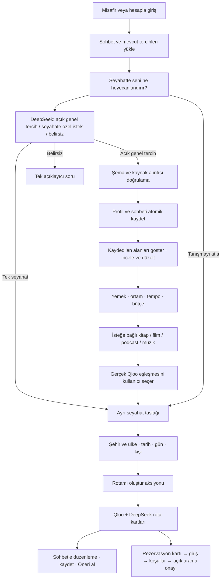

# TasteTrip — Sohbet merkezli deneyim

26 Ekim 2026 · D-032. Kullanıcının açık talimatı sohbet merkezli deneyim ve DeepSeek ile kullanıcıya ait tercih kaydıdır. D-030'un üç adımlı ana onboarding yüzeyinin yerini alır. Aşağıdaki soru sırası uygulama hipotezidir; kullanıcı araştırması yapılmadı.

## Konuşma ve kayıt sözleşmesi

- İlk soru: “Seyahat ederken seni en çok ne heyecanlandırır?” Hızlı yanıtlar örnek cümledir; serbest metin ve doğrudan planlama mümkündür.
- Sonraki sorular: “Sevdiğin mutfaklar veya ortamlar neler?”, “Nasıl bir tempoda ve bütçeyle gezersin?” Bir turda bir soru; bilinen bilgiler tekrar sorulmaz.
- İsteğe bağlı: sevilen kitap/film/sanatçı, podcast konusu, kitap/podcast dili. Dil ile konu ayrı. Modelin örnekleri envanter sınırı değildir.
- Seyahat: nereye, ne zaman, kaç gün, kaç kişi? Sonra rota oluşturma kartı. Eksik profil planlamayı kilitlemez.
- Kalıcı profil alanları mevcut profiles.py doğrulamasından geçer. Çıkarılan her değişiklik son kullanıcı mesajından birebir kaynak alıntısı ve profile kapsamı taşır. Bu kontrol anlamsal doğruluk garantisi değildir; yanlış çıkarım incele/düzelt yoluyla değiştirilebilir.
- Tek seyahate özgü istekler chat_threads.trip alanındadır; master profilden ayrıdır. Hassas özel koşullar model tarafından otomatik yazılmaz; tercih editöründe açıkça girilebilir.
- Model favori veya konu ID'si yazamaz. Qloo arama sonucu kullanıcı seçimiyle katalog doğrulamasından geçerek kaydedilir. Konu metninin saklanması tek başına Qloo tag sinyali değildir.
- SQLite sahibi user:<id> veya visitor:<opaque hash>; profil ve sohbet yanıtı aynı transaction ile kaydedilir. Sürüm çakışmasında hiçbir yarım kayıt yapılmaz. Aynı turn_id tekrar gönderilirse kayıt tekrarlanmaz (son 100 mesaj kapsamında).
- İlk ziyaret oturum cookie'si; cihazda hatırlama açık kullanıcı aksiyonu. Hesap profili kalıcıdır. Misafir profilinin hesaba aktarımı eski açık alan seçimiyle devam eder; sohbet geçmişi otomatik taşınmaz.
- Son 100 mesaj saklanır; 30 gün etkin olmayan sohbetler servis başlangıcında temizlenir. Sohbeti temizle tercihi silmez; tercih editörü profil sıfırlamayı ayrıca sunar. Yeni analitik veya ses kaydı eklenmedi.
- DeepSeek'e mevcut profil, son 16 mesaj, seyahat taslağı ve son mesaj gönderilir; anahtar tarayıcıya gönderilmez. Kullanıcıya işleme/kayıt açıklaması gösterilir.

## Görünüm, durum ve geri dönüş

Ana yüzey fotoğraflı sohbet, serbest mesaj alanı, kaydedilen alan makbuzları ve kişisel profil özeti içerir. Rota kartları aynı sayfada konuşmanın altında görünür. İkincil profil inceleme tek sayfalık editördür; eski zorunlu üç adım yoktur. Uçuş, içerik ve rezervasyon ayrıntı yüzeyleri mevcut doğrulanmış aksiyon akışlarını korur.

Dar alanda profil özeti aşağıya geçer; mesaj ve aksiyonlar sarılır. Enter gönderir, Shift+Enter satır açar; IME composition göndermez. Reduced motion kaydırma animasyonunu kaldırır. Ekran okuyucu için sohbet log, durum alanı ve mesaj etiketleri bulunur; kapsamlı erişilebilirlik uygunluk testi yapılmadı.

Beklerken gönder düğmesi kilitlenir, durum görünür ve giriş korunur. Hata olursa metin girişte kalır; yeniden gönderim aynı kimliği kullanır. Çakışmada güncel sohbet alınır ve kullanıcı yeniden gönderir. Yenilemede kayıtlı konuşma yüklenir. Giriş/çıkışta sahip değiştiğinde görünür sohbet değiştirilir; eski yanıt yeni hesaba çizilmez. Model keyfi araç/telefon çağrısı çalıştıramaz. Rezervasyon özeti ve açık ücretli arama onayı korunur.

## Kabul kanıtı ve sınırlar

tests/test_chat.py: atomik tercih+sohbet kaydı, alıntı/kapsam, sahte ID, model hatası, retry, çakışma, sahiplik, temizleme sürümü ve yalnız rota taslağı aksiyonu. Canlı ve UI kontrol sonuçları PROJECT_HISTORY H-070 altında tutulur.

Modelin bütün olası cümleleri doğru yorumlaması, otomatik tüm diller, gerçek telefon, Coolify/ARM64 deploy ve kullanıcı araştırması bu çalışma ile doğrulanmış sayılmaz. Rezervasyonun ayrıntı formu ve uçuş araması henüz tamamen doğal dille alan dolduran araçlar değildir; ana giriş/onboarding/rota komutları sohbet merkezlidir. Bu alanların konuşma içinden ayrıntı toplaması sonraki kapsamdır.

## D-033 — 26 Ekim sonraki talimat
Kullanıcı bütün deneyimi sohbet istedi. Bu belgedeki yardımcı form/ayrı yüzey sınırı tarihsel; güncel akış [Tam konuşma deneyimi](10-complete-conversation.md) içinde.
