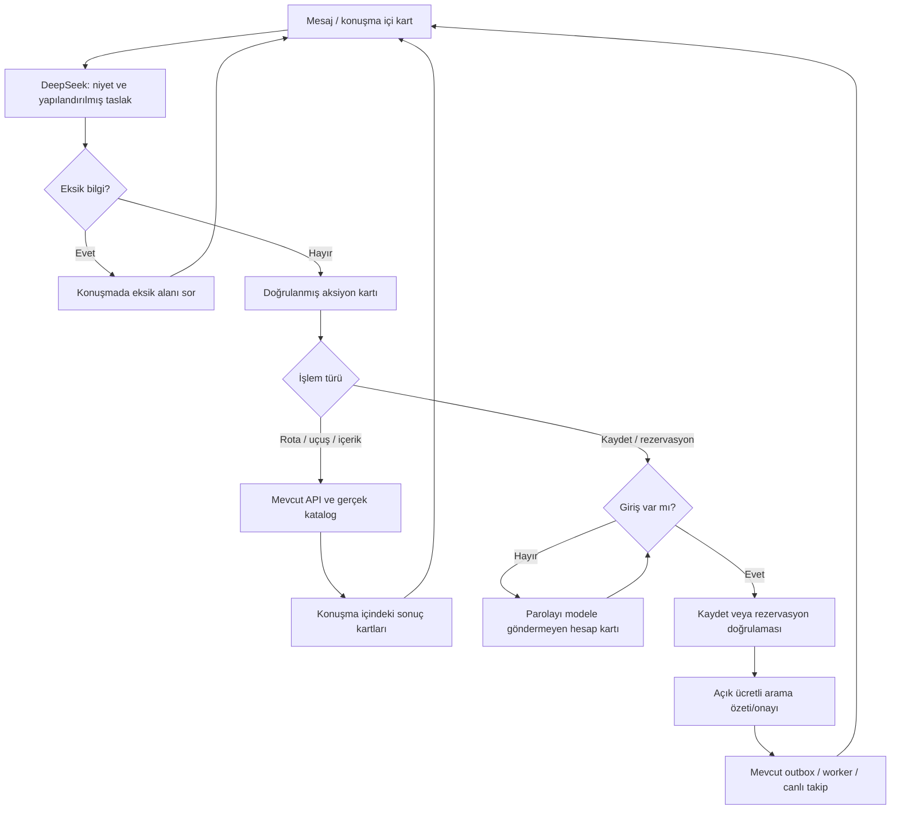

# TasteTrip — Tam konuşma deneyimi

26 Ekim 2026 · D-033. Kaynak: kullanıcı, önceki uygulamadan sonra “deneyimin tamamını bir chat deneyimine değiştir” talimatını tekrarladı. D-032/H-070'te kalan yardımcı ekran sınırı kaldırıldı. Ürün/UX skill'i kullanıldı; yeni kullanıcı araştırması yapılmadı.

## Yüzey ve davranış

Uygulama artık tam yüksekliğinde tek bir konuşmadır. Büyük fotoğraflı açılış, yan menü, ayrı rota/listeler/tercih ekranları ve modal pencereler ana deneyimden kaldırıldı. Üstteki kısa yollar konuşma içine kart ekler; kullanıcı mesaj alanını terk etmez. Mesaj alanı altta, konuşma ve sonuçlar tek kaydırma alanındadır. Fotoğraflı gerçek mekân kartları konuşmanın içinde korunur.

| İş | Konuşmada bilgi toplama | Sonuç / kontrol |
| --- | --- | --- |
| Tanışma ve tercihler | Açık genel beğeniler; bir seyahate özgü bilgiler ayrı | Kaydedilen alan makbuzu; düzenlenebilir özet ve tek tercih kaldırma düğmeleri |
| Rota | Şehir/ülke, başlangıç, gün, kişi; tempo ve kategori istekleri | Aynı konuşmada gerçek Qloo kartları ve gün seçimi; konuşmayla düzenleme |
| Rota kaydı | Kaydet talebi veya kart aksiyonu | Gerekliyse güvenli giriş kartı, ardından kayıt sonucu; Rotalarım kartından açma |
| Uçuş | Kalkış/varış şehirleri, tarih, isteğe bağlı dönüş | Gerçek havalimanı seçenekleri, açık seçim, Aviasales önbellek sonucu ve kaynak bağlantısı |
| İçerik | Durak, tür, konu/sevilen eser, kitap/podcast dili; atlanabilir | Qloo eşleşme seçimi, öneri kartları ve varsa Apple Podcasts bağlantısı; genel profile kayıt ayrı açık aksiyon |
| Rezervasyon | Rota durağı, tarih/saat, kişi, ad ve notlar; ülke/dil/saat dilimi taslakları | Telefon/yerel saat kontrol kartı → sunucuda doğrulanan immutable özet → ayrı açık ücretli arama onayı |
| Canlı görüşme | Rezervasyonlarım veya konuşma komutu | Aynı akışta dinleme/sessize alma/durdurma, native altyazı, özet ve kanıtlı sonuç incelemesi |
| Tercih aktarımı | Girişten sonra açık alan seçimi | Karşılaştırma ve aktarım kartı; otomatik hesap birleştirme yok |

Şifreler normal sohbet mesajı olarak alınmaz. Yalnız güvenli hesap kartındaki alan doğrudan auth API'sine gider; DeepSeek'e veya sohbet geçmişine gönderilmez. Rezervasyon telefon/saat kontrolü ve arama onayı LLM tarafından işaretlenemez. Konuşmada “ara” denmesi tek başına ödeme/arama başlatmaz; açık onay kartı korunur.

## Durum modeli

Görev değişince önceki taslak kaybolmaz. `chat_threads.tasks` uçuş/rezervasyon/medya taslaklarını ayrı tutar. Sunucu mevcut rotadan izin verilen durakları verir; modelin bilinmeyen durağı veya doğrulama/onay alanı yazması kabul edilmez. Rezervasyon hazırlama, başlatma, idempotency, sahiplik ve ses yetkilendirmesi mevcut production API'leriyle yürür; yeni paralel arama yolu açılmadı.

Profil değişimi, sohbet değişimi, hata ve yeniden gönderim kuralları UX09'dan devam eder. Kartların geçici seçimleri (örneğin seçilmiş havalimanı) sayfa yenilemesinde yeniden seçilebilir; kalıcı rota, profil ve rezervasyon kayıtları kendi sunucu kaynaklarından yüklenir. Geçici fiyat/öneri kartlarının bütünü kalıcı sohbet arşivi diye sunulmaz. Ana model yalnız kendisine sağlanan gerçek rota, profil ve görev bağlamına dayanabilir.

## Kontroller ve kanıt sınırı

- `tests/test_chat.py` ve `test_chat_tasks.py`: görev ayrımı, server route bağlamı, bilinmeyen durak, onay/telefon alanı reddi, tarihler, sahte medya ID'si ve açık özel koşul kaydı; mevcut rezervasyon testleri korunur.
- Ayrı `scripts/chat_ui_preview.py`: sentetik rota ve ayrı DB; Twilio hesap/token alanları boş, gerçek telefon kapalı. Ana kullanıcı hesabına sentetik tercih veya rezervasyon yazılmaz.
- Tarayıcı: sohbet içi giriş → rezervasyon sorusu → bilgilerin mesajla tamamlanması → kontrol kartı → onay özeti; telefon başlatma tıklanmadı. Görev değiştirerek İstanbul–Paris uçuşu ve gerçek havalimanı/önbellek yanıtı incelendi.
- Son test sayısı, responsive ölçümü ve görsel kaydı PROJECT_HISTORY H-071'de tutulur. Gerçek telefon veya Coolify/ARM64 yayını bu UI çalışmasının doğrulaması değildir. Bütün doğal dil ifadelerinin doğru anlaşılması garanti edilmez.

Kullanıcı seçimleri sohbet kartlarında hâlâ buton/checkbox ve kanıt satırı seçimi gibi kontroller içerir. Bunlar ayrı sayfa veya uzun bilgi toplama formu değildir; açık kontrol gerektiren kararlar konuşmanın içinde kalır.

### 28 Ekim 2026 — D-035: Karşılama ve sohbet dili
İlk ekran ve karşılama İngilizcedir. Asistan son kullanıcı mesajının dilinde yanıt verir; açık dil değişikliği isteği önceliklidir. Belirsiz kısa mesajlarda önceki konuşma dili, ilk temasta İngilizce kullanılır. Mesaj dili native/altyazı tercihini otomatik değiştirmez. Eski konuşmalar yeniden çevrilmez. Yardımcı işlem kartlarının tam yerelleştirmesi ayrıca ele alınacaktır.

### 28 Ekim 2026 — D-036: İngilizce uygulama metinleri
D-035 sonundaki yardımcı kartların daha sonra çevrileceği sınırı kaldırıldı. Tüm sabit uygulama metinleri, kart/aksiyon etiketleri, erişilebilir açıklamalar ve servis hata mesajları İngilizcedir. Asistan son mesaj dilinde yanıt verir; önceki konuşma dili ancak dil bakımından belirsiz girişlerde kullanılır. Dil yönlendirmesi ayrı hafif LLM çağrısıyla yapılır; native/altyazı tercihini değiştirmez. Kalıcı enum kimlikleri korunur ve İngilizce etiketle gösterilir. Kullanıcı içeriği ve eski sohbet kayıtları silinmez.

### 28 Ekim 2026 — D-037: Ayrı kayıt girişi
Üst barda Sign in yanında Sign up bulunur. Kayıt, sohbet içindeki ayrı modda username/password/confirmation ile yapılır; giriş moduna geçilebilir. Kayıttan sonra otomatik oturum ve bekleyen işe dönüş korunur. Ayrıntı: docs/ux/11-signup-and-signin.md.
