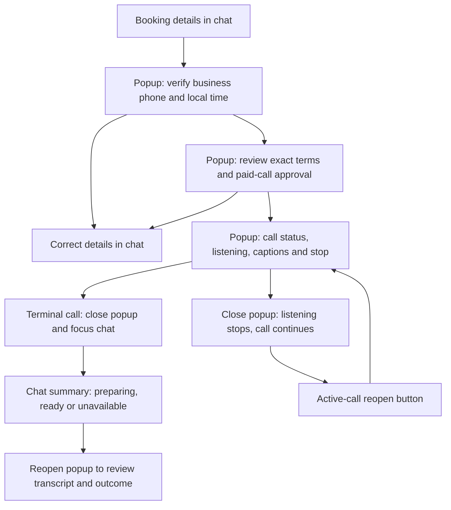

# Reservation call popup

28 October 2026 · D-039 / H-082 · User-adopted scope, locally implemented.

Booking details are collected in chat. Review booking conditions opens a native modal above the conversation. This explicitly replaces the reservation and live-call card behavior from D-033; other tools remain in chat.

## Interface and recovery contract

- Native dialog/backdrop blocks background interaction and contains keyboard focus. Close and Escape leave the call running; the disclosure explains this. Stop the call retains its existing explicit control and meaning.
- Step 1 requires both phone/business and time-zone checks. Step 2 starts unchecked and requires separate approval of the exact paid-call summary. Existing digest, idempotency and server checks remain authoritative.
- Live listening remains user-triggered and requires no microphone. Transcript/translation, service errors, outcome evidence review and summary retry stay inside the popup.
- Active-call and summary polling survive closing the popup. On ended/failed/busy/no-answer/canceled/rejected the followed call returns to chat. Unknown is unresolved and does not trigger completion.
- Summary preparation is asynchronous. One chat card updates in place with the existing reservation record; it does not claim that the automatic summary proves confirmation. Failed/insufficient summaries can be retried without dialing again. Expired records explain retention expiry.
- Reopening a completed record leaves the modal open for review. Account changes close the popup and stale poll responses are discarded.
- CSS uses a centered, scrollable desktop window and near-fullscreen narrow layout; the transcript has its own bounded scroll area. Reduced-motion preferences remain respected by the existing chat.
- Reservation records are durable backend objects; chat tool cards retain the existing transient presentation lifecycle. Reloaded users can recover records from My reservations.

## Evidence and limits

126 Python tests passed. Isolated 8085 synthetic fixture exercised verification denial, separate approval, simulated live text, close/reopen, terminal return, pending/ready summary and transcript recovery. No real calls were made. Screenshots are in artifacts/ux/call-popup-*.png. The viewport override remained 1280px, so actual narrow mobile rendering remains unverified. This change has not been deployed.

## Deployment update — 28 October 2026 / H-083
Reservation popup commit 1f6963f deployed successfully through Coolify e108e5kfbekev7mh667pcjds. Web/gateway/worker healthy; public HTTPS health 200, worker available, versioned popup asset present. Existing one user and two saved plans preserved. No actual telephone call was made. This supersedes the earlier not-deployed status; earlier evidence remains historical.
